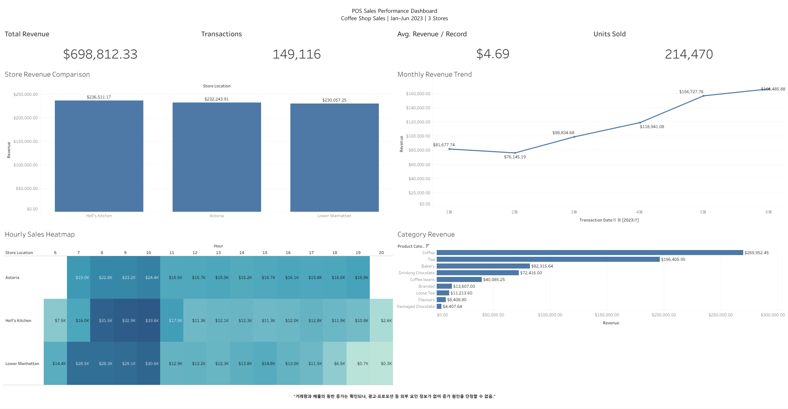

# POS 거래 데이터 기반 매장 매출 분석 및 운영 개선 전략

> **SQL Server + Tableau Public | 개인 포트폴리오 프로젝트**  
> 가상 카페의 판매 기록을 바탕으로, POS 매장 운영자가 어떤 지표를 확인하고 어떤 실행 가설을 세울 수 있는지 분석했습니다.

## 1. 프로젝트 개요

- **분석 대상:** Maven Roasters (가상의 뉴욕 커피숍 3개 매장)
- **기간:** 2023-01-01 ~ 2023-06-30 (181일)
- **데이터:** 총 149,116개 고유 거래 기록, 11개 원본 컬럼
- **활용 기술:** SQL Server(T-SQL), SSMS, Tableau Public
- **핵심 목표:** 매장별·시간대별·카테고리별 매출 차이를 파악하고 매장 운영 개선 가설을 제안
- **자료 출처:** [Maven Analytics — Coffee Shop Sales](https://mavenanalytics.io/data-playground/coffee-shop-sales) (가상 데이터, 공식 페이지의 라이선스: Public Domain)

**프로젝트 성격:** 공개된 가상 판매 데이터를 독립적으로 분석한 개인 프로젝트이며, 실제 매장 운영 데이터나 외부 기업과의 공동 프로젝트가 아닙니다.

## 2. 비즈니스 질문

1. 매장 간 매출 차이는 거래 기록 수 때문인지, 기록당 판매 금액 때문인지?
2. 매출이 집중되는 요일·시간은 언제이며 매장 간 차이가 있는지?
3. 어떤 상품 카테고리가 매출을 주도하며 이를 운영에 어떻게 활용할 수 있는지?

## 3. 데이터 검증과 지표 정의

| 검증 항목 | 결과 |
|---|---:|
| 원본 거래 기록 | 149,116건 |
| 고유 `transaction_id` | 149,116건 (ID 중복 0건) |
| 결측 필드 | 0건 |
| 수량 0 이하 / 가격 0 이하 | 0건 |
| 분석된 날짜 | 181일 (2023-01-01 ~ 2023-06-30) |

`Revenue = transaction_qty * unit_price`를 사용합니다. 이는 **판매 기록 금액 합계**이며, 취소·할인·세금·환불을 반영한 순매출 또는 결제 정산액과 다를 수 있습니다.

**지표 계산**

```sql
SUM(CAST(transaction_qty AS DECIMAL(18,2)) * unit_price) AS revenue
COUNT(DISTINCT transaction_id) AS transaction_records
SUM(transaction_qty) AS units_sold
SUM(CAST(transaction_qty AS DECIMAL(18,2)) * unit_price)
  / NULLIF(COUNT(DISTINCT transaction_id), 0) AS revenue_per_record
```

거래 ID는 중복되지 않지만, 실제 고객의 여러 상품이 하나의 주문에 묶였는지는 확인할 수 없습니다. 따라서 **`revenue_per_record`는 '기록당 평균 매출'**이며 고객 1인당 지출이나 다품목 주문의 실제 객단가라고 단정하지 않습니다.

## 4. 주요 분석 결과

### 4.1 전체 KPI

| 지표 | 결과 |
|---|---:|
| 매출 합계 | **$698,812.33** |
| 고유 거래 기록 | **149,116건** |
| 판매 수량 합계 | **214,470개** |
| 기록당 평균 매출 | **$4.69** |

### 4.2 월별 변화 — 거래 기록 수와 매출의 동반 증가

| 월 | 매출 | 거래 기록 수 | 관측 일평균 매출 | 기록당 매출 |
|---|---:|---:|---:|---:|
| 2023-01 | $81,677.74 | 17,314 | $2,634.77 | $4.72 |
| 2023-02 | $76,145.19 | 16,359 | $2,719.47 | $4.65 |
| 2023-03 | $98,834.68 | 21,229 | $3,188.22 | $4.66 |
| 2023-04 | $118,941.08 | 25,335 | $3,964.70 | $4.69 |
| 2023-05 | $156,727.76 | 33,527 | $5,055.73 | $4.67 |
| 2023-06 | $166,485.88 | 35,352 | $5,549.53 | $4.71 |

- 1월 → 6월 **매출 +103.8%**, **거래 기록 수 +104.2%**입니다.
- 기간별 일수 차이를 보정한 일평균 매출도 **$2,634.77 → $5,549.53**로 늘었습니다.
- 기록당 평균 매출은 **$4.72 → $4.71**로 거의 변하지 않아, 이 기간의 총매출 성장에는 거래 기록 수 증가가 중요한 설명 요소입니다.
- 다만 고객 방문 수가 없어 방문객 증가, 구매전환 개선 등 **원인을 확정할 수는 없습니다.**

**월별 변화의 원인 분해: 월 길이 / 일평균 거래 / 기록당 매출**

| 비교 | 월매출 변화 | 일평균 매출 변화 | 일평균 거래 기록 변화 | 기록당 매출 변화 |
|---|---:|---:|---:|---:|
| 1월 → 2월 | **-6.8%** | **+3.2%** | **+4.6%** | **-1.3%** |
| 2월 → 3월 | **+29.8%** | **+17.2%** | **+17.2%** | **+0.02%** |
| 4월 → 5월 | **+31.8%** | **+27.5%** | **+28.1%** | **-0.4%** |

1. **1월 → 2월:** 2월(28일)은 1월(31일)보다 짧습니다. 월합계는 줄었지만 일평균 매출은 $2,634.77에서 $2,719.47로 증가했습니다. 따라서 월매출 하락을 곧바로 수요 감소라고 해석하면 안 됩니다.
2. **2월 → 3월:** 월매출은 $22,689.49 증가했으며, 세 매장의 증가액은 Astoria $7,730.09, Lower Manhattan $7,568.63, Hell's Kitchen $7,390.77입니다. 상품군 증가액도 Coffee $9,034.65, Tea $6,177.25, Bakery $2,863.76로 폭넓게 나타납니다.
기록당 평균 매출은 사실상 일정하고 일평균 거래 기록은 약 584건에서 685건으로 늘었습니다.
3. **4월 → 5월:** 월매출은 $37,786.68 증가했고, 세 매장 모두 약 $12,295~12,951 늘었습니다. Coffee $14,391.65, Tea $11,182.90가 증가액의 대부분을 설명합니다. 오전 8~10시 매출 증가액은 약 $13,823.46으로 전체 증가분의 약 36.6%입니다.
일평균 거래 기록은 약 845건에서 1,082건으로 늘었지만 기록당 매출은 약 $4.69에서 $4.67로 소폭 감소했습니다.

**관측된 매출 성장과 외부 요인에 대한 한계**

| 비교 기간 | 거래 기록 수 | 판매 수량 | 매출 변화 |
|---|---:|---:|---:|
| 2월 → 3월 | 16,359 → 21,229건 (+29.8%) | 23,550 → 30,406개 (+29.1%) | +29.8% |
| 4월 → 5월 | 25,335 → 33,527건 (+32.3%) | 36,469 → 48,233개 (+32.3%) | +31.8% |

- **데이터로 확인할 수 있는 사실:** 두 성장 구간 모두 거래 기록 수와 상품 판매 수량이 증가했습니다. 반면 기록당 평균 매출은 큰 변화가 없어, 매출 증가에는 거래량 확대가 주요하게 *동반*되었습니다. 이는 매출의 **구성 요소에 대한 설명**입니다.
- **이 데이터로 확인할 수 없는 원인:** 원본에는 해당 시기에 광고가 집행되었는지, 마케팅 예산·노출·클릭·쿠폰·프로모션 등 외부 변수가 어떻게 달라졌는지에 대한 기록이 없습니다. 따라서 **광고나 프로모션이 거래량을 늘렸는지, 그 외 계절성·고객 유입·영업시간 변화가 영향을 주었는지 판단할 수 없습니다.** 외부 요인이 없었다는 의미도 아닙니다.
- **추가 검증 계획:** 캠페인 집행 일자와 비용, 프로모션·할인 로그, 일별 방문객 및 주문 건수, 영업시간·휴무 기록을 확보해 변화 전후를 비교하고, 가능하다면 통제집단이나 A/B 테스트를 통해 효과를 검증해야 합니다.

### 4.3 매장별 비교

| 매장 | 매출 | 거래 기록 수 | 기록당 매출 | 기록당 수량 |
|---|---:|---:|---:|---:|
| Hell's Kitchen | $236,511.17 | 50,735 | $4.66 | 1.41 |
| Astoria | $232,243.91 | 50,599 | $4.59 | 1.40 |
| Lower Manhattan | $230,057.25 | 47,782 | $4.81 | 1.50 |

Lower Manhattan은 거래 기록 수가 가장 적지만 기록당 매출과 수량은 가장 높습니다. 이는 매장별 판매 구성을 추가 확인할 이유가 되며, **고객당 구매액이나 객수의 차이를 입증하는 근거는 아닙니다.**

### 4.4 시간대·상품군 특징

- **08~10시 매출 비중: 36.7%**, 세 매장 모두 **10시가 매출 최대 시간대**였습니다.
- 카테고리 매출 1위는 Coffee **$269,952.45(38.6%)**, 2위 Tea **$196,405.95(28.1%)**입니다.
- 두 카테고리 합계는 총매출의 **66.7%**입니다.

## 5. Tableau 대시보드

[Tableau 통합 문서 열기](tableau/Coffee_Shop_Sales_Dashboard.twbx)

실제 작업한 Tableau Public Edition 통합 문서입니다. 다음 항목을 구현했습니다.

- **KPI 4종:** 총매출, 거래 기록, 기록당 평균 매출, 판매 수량
- **차트 4종:** 매장별 매출, 월별 추세, 시간대별 매출 히트맵, 상품 카테고리별 매출
- **인터랙션:** 매장 막대 선택으로 다른 지표와 차트에 필터 적용

> 대시보드의 `Avg. Transaction Value`는 자료의 제약상 **기록당 평균 매출**로 해석해야 합니다. 제출 전 레이블을 `Avg. Revenue per Record`로 변경하면 보다 정확합니다.

## 6. 운영 개선 가설 (관측과 제안 구분)

| 관측된 데이터 | 실행 제안(가설) | 후속 검증 지표 |
|---|---|---|
| 08~10시 매출 집중, 세 매장 10시 피크 | 피크 시간대 준비량·근무 인원 조정 테스트 | 품절률, 고객 대기시간, 시간당 매출/인건비 |
| Coffee·Tea 매출 66.7% | 음료-베이커리 연계 판매 가설을 소규모로 실험 | 추가 상품 판매율, 기록당 매출, 순매출 |
| Lower Manhattan 기록당 매출 최고 | 상품군 구성·주문 단위 확인을 위한 로그 추가 확보 | 주문당 수량, 객수, 구매 전환율 |

위 제안은 **실행 실험에서 검증해야 하는 가설**이며, 이 데이터만으로 개선 효과를 주장하지 않습니다.

## 7. 한계와 향후 분석

- **주문 및 고객 ID 부재:** 고객 재방문, 코호트 리텐션, 다품목 장바구니 관계 분석 불가
- **할인·환불·결제 방식·원가 부재:** 실매출, 마진, 결제수단별 승인/실패 분석 불가
- **외부 요인 데이터 부재:** 광고 집행·마케팅 예산·프로모션·방문객·영업시간·인력·재고 기록이 없어 매출 증가의 인과적 원인을 판단할 수 없음
- **가상 데이터:** 실제 매장 운영에 적용하기 전 운영 데이터로 재검증 필요

## 8. 저장소 구성 및 실행

```text
coffee_shop_portfolio/
├── README.md
├── report/
│   └── Coffee_Shop_Sales_Analysis_Portfolio.pdf
├── sql/
│   ├── 01_create_database.sql
│   ├── 02_import_csv.sql
│   ├── 03_check_data.sql
│   ├── 04_sales_analysis.sql
│   ├── 05_sales_metrics.sql
│   └── 06_monthly_sales_changes.sql
├── tableau/
│   └── Coffee_Shop_Sales_Dashboard.twbx
└── data/
    └── README.md
```

1. 데이터 출처의 원본 Excel을 내려받습니다.
2. `sql/01_create_database.sql`로 SQL Server 테이블을 만들고, `02_import_csv.sql`의 **개인 PC 경로**를 수정해 적재합니다. (원본 Excel을 CSV로 변환해야 합니다.)
3. `03_check_data.sql`로 검증한 뒤 `04_sales_analysis.sql`, `05_sales_metrics.sql`, `06_monthly_sales_changes.sql`을 실행합니다.
4. Tableau Public Desktop Edition에서 `.twbx`를 열어 필터와 KPI를 확인합니다. 데이터가 포함된 `.twbx`라 열람이 가능하지만, 데이터 원본 **새로고침에는 로컬 CSV 경로 재설정**이 필요할 수 있습니다.

## 9. 출처

- [Maven Analytics - Coffee Shop Sales](https://mavenanalytics.io/data-playground/coffee-shop-sales) · 가상 거래 데이터 / Public Domain 표기

---

## Tableau Dashboard


